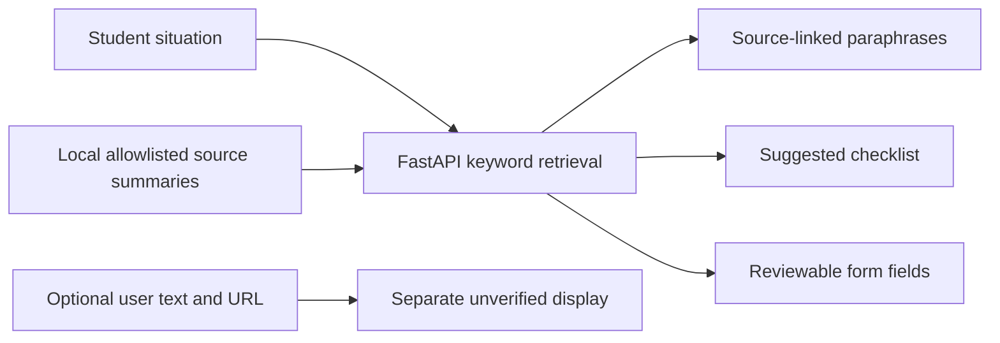

# HackGlobal submission draft: CiteDesk

**Entrant:** Kağan Arıbaş
**Team:** kegan (solo)
**Track:** ML/AI, Track 03 Grounded knowledge and RAG; overlaps with Track 01 Agentic and GenAI apps and Track 04 Civic and real-world impact.

## Problem and solution

International students face fragmented rules, unfamiliar procedures and inconsistent advice. CiteDesk turns a situation into source-linked summaries, suggested next steps and draft form fields for review. It serves students navigating mobility and international offices answering recurring questions. The prototype focuses on Romanian student residence, Erasmus+ learning agreements and health coverage.

## System design

The local corpus contains manually written demo paraphrases and official links, not a live scrape. Templated output requires no model or paid API. Users verify current rules and review every field. The app never sends forms to an office. Checklist dates are suggestions, not deadlines. The first form mapping is a limited manual subset and the optional text is not used as evidence.

## Implemented and next decisions

The local prototype includes a web interface, FastAPI endpoint, three source records, keyword matching, citations, checklist, limited form drafts, and explicit evidence gaps. See DEMO.md for the walkthrough and STATUS.md for verification.

Kağan's decisions and further work are needed for a public repository, Vultr backend deployment, recorded demo running on Vultr, a public product-style demo URL, and Vultr Community submission. None has been performed. Validate official sources, eligibility logic, dates, form coverage, privacy, security and accessibility before real use. Collect user feedback across countries and team/community participation separately; no reach is claimed here.
